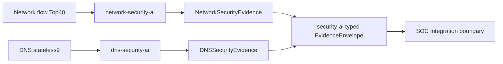

# Security AI — Network + DNS

Network와 DNS 모델을 SOC Agent 없이 설치·추론·테스트하는 통합 Python 패키지입니다.
기존 Network 공개 API는 그대로 재사용합니다. DNS 추론의 canonical source는
`packages/dns-security-ai`이며 상위 패키지는 API 재노출과 typed evidence envelope만 제공합니다.
각 모델은 별도 feature contract, prediction, score 의미를 유지합니다.

Artifact 준비·선택 설치·HTTPS 다운로드는 [버전별 설치 가이드](../../docs/security_ai/artifact_installation.md)를
사용합니다. 새 installer도 이 패키지에서 제공하며 Network/DNS predictor API는 변경하지 않습니다.

## 모델과 실제 근거

| 모델 | 관측 단위 / 입력 | 출력 / score | 확인한 성능 근거 |
|---|---|---|---|
| Network LightGBM V4-B2 | Network flow Top40 | 15-class probability; threat_score=1−P(Benign) | 저장된 full validation Macro F1 0.8086545335, 2,390,002 rows |
| Network DNN FP32 epoch13 | Network flow Top40 | 동일 Network prediction | 저장된 full validation Macro F1 0.6986469531, 2,390,002 rows |
| DNS DNN INT8 TFLite | stateless DNS record 9 features | binary NORMAL/MALICIOUS; 미보정 P(MALICIOUS), threshold=0.5 | 정확도·학습/변환 provenance **UNVERIFIED** |

Network 수치는 기존 `results/lightgbm_top40_v4b2/metrics.csv` 및
`results/dnn_top40_v4/dnn_fp32_full_valid_metrics.csv`에서 재확인한 저장 결과이며,
이번에 다시 평가한 정확도가 아닙니다. 새로운 holdout 또는 운영 성능이 아닙니다.
DNS notebook의 다른 모델 성능은 배포 DNN에 적용하지 않습니다.
이번에는 재학습·tuning·Test 데이터 재사용 없이 합성 입력 smoke만 실행했습니다.

## Architecture



Network와 DNS를 같은 이벤트로 합치거나 score를 합산하지 않습니다.
모델은 최초 predict에서 선택적으로 로딩되며 실행하지 않은 backend는 로딩되지 않습니다.
패키지 base dependency는 가벼운 schema/NumPy이며 torch/LightGBM/LiteRT/TensorFlow는 extras입니다.
DNS만 설치할 때는 `dns-security-ai`, Network만 설치할 때는 기존 `network-security-ai`를 선택할 수 있습니다.

## 설치

ML root에서 Python 3.12+, uv:

```bash
# 가벼운 base import / unit tests
uv sync --project packages/security-ai

# 사용할 backend만 설치
uv sync --project packages/security-ai --extra network-quality --extra dns-litert
# Network edge가 필요하면 --extra network-edge 추가
# DNS 원래 TensorFlow runtime은 --extra dns-tensorflow와 --runtime tensorflow 선택
```

`tool.uv.sources`가 이 저장소의 두 독립 패키지를 참조합니다. Registry에 이미 공개되었다고
가정하지 않습니다. 다른 프로젝트에는 세 wheel을 함께 전달해 설치할 수 있습니다.

```bash
uv build --project packages/network-security-ai --out-dir /tmp/security-ai-dist
uv build --project packages/dns-security-ai --out-dir /tmp/security-ai-dist
uv build --project packages/security-ai --out-dir /tmp/security-ai-dist
uv pip install --find-links /tmp/security-ai-dist 'security-ai[network-quality,dns-litert]==0.1.0'
```

의존성은 미리 설치하거나 네트워크/승인된 cache가 있어야 합니다. 모델 다운로드 URL은
미정입니다. Wheel/sdist에는 모델 파일·데이터·SOC 코드가 포함되지 않습니다.

## Trusted artifact 준비와 integrity

Network root 기본 경로:

```text
<network-root>/models/network/
├── lightgbm_top40_v4b2.txt      # 48,637,456 bytes
├── dnn_top40_v4_best.pt        # 398,041 bytes
└── dnn_top40_v4_scaler.joblib  # 1,543 bytes
```

DNS root 기본 경로:

```text
<dns-root>/
├── model/dnn_int8.tflite       # 9,288 bytes
└── preprocessor/scaler.joblib # 1,135 bytes
```

로컬 DNS 원본은 `packages/dns_security_package/dns_security_package/dns_security/`에
보존했습니다. 이름·크기·SHA-256은 [artifact inventory](../../reports/security_ai/artifact_inventory.json),
버전·feature·dependency는 각 독립 패키지의 `artifact_manifest.json`에 있습니다.
Network 작은 Top40/label metadata와 DNS feature contract/manifest만 wheel에 포함됩니다.

관리자가 신뢰하는 bundle을 root에 준비하고 다음 코드로 선택 파일을 확인합니다.

```python
from pathlib import Path
from dns_security_ai import DNSConfig
from dns_security_ai.artifacts import verify_bundle
from network_security_ai import NetworkSecurityAIConfig, Top40Contract

verify_bundle(DNSConfig(artifact_root=Path("/trusted/dns")))
config = NetworkSecurityAIConfig(artifact_root=Path("/trusted/network"))
Top40Contract(config).verify_artifact(config, "lightgbm_path")
```

Load 시에도 checksum과 모델/scaler 계약을 검증합니다. Root/manifest는 신뢰하는 관리자가
통제해야 하며 checksum이 출처 인증을 대신하지 않습니다. 특히 joblib은 신뢰하지 않는
pickle을 실행할 수 있으므로 출처를 확인한 팀 artifact만 사용합니다.
배포는 검토된 immutable bundle을 Release 또는 사내 artifact storage로 공유하는 방식을
권장합니다. Git/LFS/Release/storage 비교와 URL 미확정 상태는 [보고서](../../reports/Security_AI_Integration_Report.md)에 기록합니다.

## Network 추론 예제

```python
import json
from pathlib import Path
from security_ai.network import (
    NetworkSecurityAIConfig,
    create_network_security_ai,
    prediction_to_evidence,
)
from security_ai import to_envelope

features = json.loads(
    Path("packages/network-security-ai/examples/synthetic_top40.json").read_text()
)
model = create_network_security_ai(
    NetworkSecurityAIConfig(
        enabled=True,
        profile="detection_quality",
        artifact_root=Path("."),
    )
)
assert model is not None
prediction = model.predict(features)
evidence = prediction_to_evidence(prediction, flow_reference="opaque-flow-ref")
envelope = to_envelope(evidence)
print(envelope.model_dump_json(indent=2))
```

기존 `network_security_ai` import와 API도 그대로 사용 가능합니다.
Network NaN/Inf/None의 기존 처리 방식도 보존합니다.

## DNS 추론 예제

```python
import json
from pathlib import Path
from security_ai.dns import DNSConfig, DNSPredictor, prediction_to_evidence
from security_ai import to_envelope

features = json.loads(
    Path("packages/dns-security-ai/examples/synthetic_stateless9.json").read_text()
)
model = DNSPredictor(
    DNSConfig(
        artifact_root=Path("packages/dns_security_package/dns_security_package/dns_security"),
    )
)
evidence = prediction_to_evidence(model.predict(features), observation_ref="opaque-dns-ref")
print(to_envelope(evidence).model_dump_json(indent=2))
```

DNS는 정확히 `FQDN_count, subdomain_length, numeric, entropy, special, labels,
labels_max, labels_average, len` 순서의 float32 input을 재현합니다.
None/NaN/Inf·negative·numeric 문자열은 거부합니다. 저장된 scaler를 transform만 하며 fit하지 않습니다.
Raw domain에서 feature를 생성하는 extractor는 제공하지 않습니다.

## CLI / 순차 실행

```bash
uv run --project packages/security-ai --extra network-quality python -m security_ai network \
  --artifact-root . --input packages/network-security-ai/examples/synthetic_top40.json
uv run --project packages/security-ai --extra dns-litert python -m security_ai dns \
  --artifact-root packages/dns_security_package/dns_security_package/dns_security \
  --input packages/dns-security-ai/examples/synthetic_stateless9.json
```

두 모델을 순차 실행할 때는 위 두 명령이나 두 별도 predictor에 각각의 입력을 전달합니다.
각 CLI는 다른 프로세스에서 종료하며 모델 메모리를 해제합니다. 같은 프로세스에서는
필요한 predictor만 생성하고 각각의 typed 예외를 처리합니다. 한 모델 실패를 정상 판정이나
다른 모델 실패로 전파하는 orchestrator는 없습니다.
CLI JSON 크기는 64 KiB로 제한하며 중복 key·extra model metadata를 거부합니다.

## Evidence

Schema: `security-ai-envelope-v1`, `network-evidence-v1`, `dns-evidence-v1`.
다음은 실제 DNS smoke에서 생성한 envelope의 일부입니다. 전체 출력은
[dns_smoke.json](../../reports/security_ai/dns_smoke.json)의 `output`에 있습니다.

```json
{
  "schema_version": "security-ai-envelope-v1",
  "source": "dns_security_ai",
  "evidence_type": "dns_threat_prediction",
  "model_id": "dns_cicbell_dnn_int8",
  "model_version": "int8-sha256-28e089af363d",
  "observation_ref": null
}
```

전체 객체에는 unique `evidence_id`, 추론 `timestamp`, typed `payload`가 포함됩니다.
Network payload는 15 probabilities/confidence/threat_score, DNS payload는
probability/threshold/score_type/artifact digests를 보존합니다. Envelope에 공통 confidence는 없습니다.
Evidence와 nested prediction/provenance는 immutable입니다. UUID·시각은 receipt metadata이며
원본 event identity/time을 만들어내지 않습니다. Observation 참조는 호출자가 제공해야 합니다.
Serialization은 구조 검증이며 cryptographic origin 인증이 아닙니다.

## 오류 / 테스트 / 빌드

모델별 input/artifact/inference/output 예외와 Pydantic metadata 오류를 그대로 전달합니다.
실패 모델만 degraded로 처리하고 score=0/정상 prediction을 대신 생성하지 마세요.
CLI는 실패 시 exit 1, 성공 시 evidence envelope JSON을 반환합니다.

```bash
uv run --project packages/security-ai --extra dns-litert pytest -q \
  -c packages/security-ai/pyproject.toml packages/security-ai/tests packages/dns-security-ai/tests
uv run --project packages/network-security-ai pytest -q \
  -c packages/network-security-ai/pyproject.toml packages/network-security-ai/tests
uv run --project packages/security-ai ruff check packages/security-ai packages/dns-security-ai \
  scripts/security_ai_smoke.py scripts/verify_dns_legacy_parity.py
uv run --project packages/security-ai ruff format --check packages/security-ai packages/dns-security-ai \
  scripts/security_ai_smoke.py scripts/verify_dns_legacy_parity.py
```

Wheel/sdist 명령은 설치 절에 있습니다. 실제 테스트 수·smoke·resource·build 결과는
[최종 보고서](../../reports/Security_AI_Integration_Report.md)에 기록합니다.
아무 artifact가 없어도 import와 대부분 unit/integration tests를 실행할 수 있습니다.
전처리 parity 테스트만 sklearn/pandas extra가 필요하며 실제 artifact를 사용하지 않습니다.

## 알려진 한계 / SOC 경계

DNS DNN training/export provenance, scaler train-only fit 및 동일 학습 실행 pairing,
정확도·calibration·threshold 근거·domain/session/time holdout은 UNVERIFIED입니다.
Native TensorFlow 실행은 이번 검증에서 UNVERIFIED입니다.
Network 기존 검증 결과도 독립 holdout/운영 일반화로 해석하지 않습니다.
Batch API는 단일 관측용이며 resource report의 batch32는 순차 호출 시간입니다.

패키지 책임은 feature validation → trusted artifact verification → inference → evidence까지입니다.
SOC의 Evidence Fusion, ThreatAssessor, Investigation, Policy, Approval, Execution은 별도 단계입니다.
기존 SOC의 `AISignal`/incident reference 검증에는 추후 별도 adapter가 필요하며 이 envelope가
자동으로 SOC 내부 evidence가 되지는 않습니다. 이번 작업은 SOC 소스를 수정하지 않았습니다.
[SOC integration contract](../../docs/security_ai/soc_integration_contract.md)를 참조하세요.

## Artifact distribution v1

Network/DNS artifact 설치는 버전별 pinned bundle로 제공합니다.
[Artifact 설치 가이드](../../docs/security_ai/artifact_installation.md)에서 설치 경로·SHA-256·선택 다운로드·오류 처리와 검증 명령을 확인하세요.

```bash
uv run --project packages/security-ai --frozen python -m security_ai artifacts install \
  --bundle-dir /path/to/trusted-bundles --artifact-root ./artifacts --model all
uv run --project packages/security-ai --frozen python -m security_ai artifacts verify \
  --artifact-root ./artifacts --model all
# 실제 GitHub Release 게시 이후
uv run --project packages/security-ai --frozen python -m security_ai artifacts download \
  --artifact-root ./artifacts --model all --version security-ai-artifacts-v1
```

설치 후 Network config root는 `./artifacts`, DNS config root는 `./artifacts/dns`입니다.
GitHub API가 반환한 실제 asset URL만 다운로드하며 package catalog의 archive/member SHA-256을 검증합니다.
기존 정상 파일은 재사용하고 다른 기존 파일을 덮어쓰지 않습니다. Predictor API와 evidence schema는 그대로 유지합니다.
